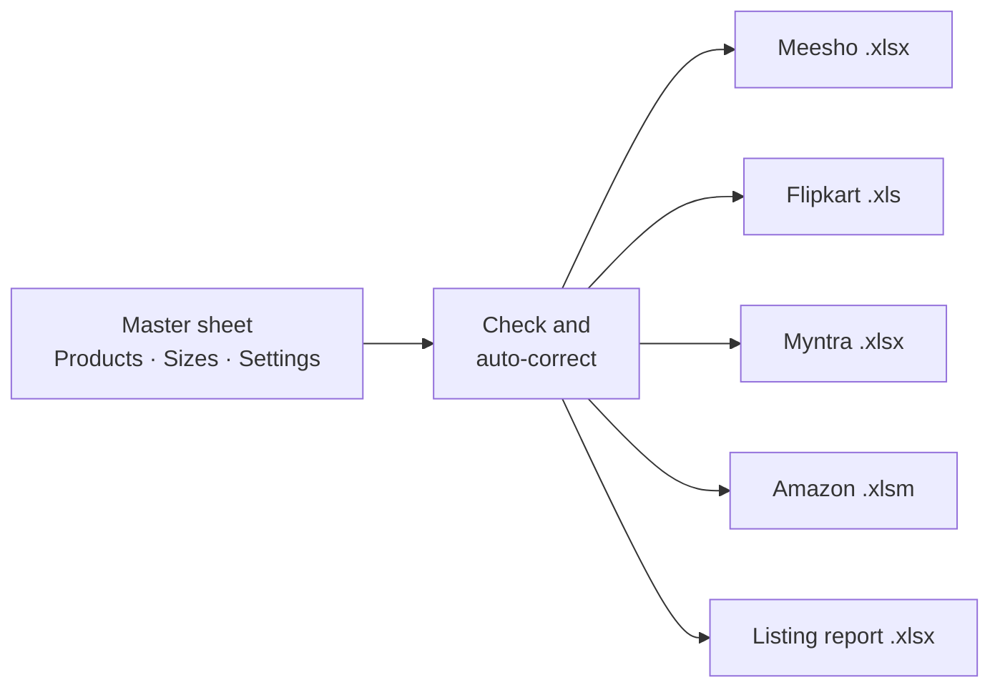

<div align="center">

# Wish Karo Listing Tool

**One master sheet in. Ready-to-upload files for Meesho, Flipkart, Myntra and Amazon out.**


</div>


The listing team fills in **one Excel master sheet**. The tool checks it, corrects common typing
mistakes, and fills each marketplace's **own upload template**, keeping their dropdowns, hidden
sheets and formatting exactly as the marketplace shipped them. A report lists anything to fix
before uploading.

It runs on one office laptop, costs nothing to run, needs no database and no AI.

---

## Contents

- [What it does](#what-it-does)
- [Daily use](#daily-use)
- [Setting up a laptop (one time)](#setting-up-a-laptop-one-time)
- [How updates reach the laptop](#how-updates-reach-the-laptop)
- [The master sheet](#the-master-sheet)
- [Marketplace rules](#marketplace-rules)
- [For the developer](#for-the-developer)
- [Common changes](#common-changes)
- [Troubleshooting](#troubleshooting)
- [Accuracy](#accuracy)
- [Known limits](#known-limits)

---

## What it does



| Output | What is in it |
|---|---|
| **Meesho** `.xlsx` | Listed under the Silver Kraft brand. Designs grouped as Group 01–30; a new file starts after 30 groups. |
| **Flipkart** `.xls` | Flipkart's old Excel format, written with LibreOffice. One row per size. |
| **Myntra** `.xlsx` | One style group per colour and MRP. Article names cut to 40 characters. |
| **Amazon** `.xlsm` | Amazon's new template. One parent row per design, then one row per size. |
| **Listing report** `.xlsx` | Every problem, check and automatic correction, one line per product. |

**Corrected automatically** (each one is listed after a run under *Fixed automatically*):

- Double and stray spaces in titles, descriptions, style codes and image links
- Prices typed as `Rs. 749` or `₹749`, sizes typed as `6 - 7 years` or `3-6m`
- Dropdown values typed in the wrong capitals
- The same colour typed on several rows (merged into one)
- A secondary colour equal to the primary colour, a shoulder value copied from front length
- An impossible Meesho kids weight for the size
- "Wishkaro" in Meesho text (Meesho sells under Silver Kraft)

---

## Daily use

1. Double-click **`start_website`** (desktop shortcut). Keep the black window open while working.
2. The tool opens at **http://localhost:5050**. A green **Connected** dot means it is ready.
3. Drag the filled master sheet onto **New run** and click **Generate files**.
4. About a minute later the zip downloads. The screen shows one of:

| Result | What to do |
|---|---|
| 🟢 **Ready to upload** | Upload each file in its seller panel. |
| 🟡 **Review** | Read the points, then upload. |
| 🔴 **Must fix** | Correct those rows in the master sheet and generate again. |

The **Help** button in the tool explains every rule. Files stay downloadable for 2 hours.

<details>
<summary>Without the website (command line)</summary>

Drag the filled master sheet onto **`generate_listings.bat`**. The files appear next to the sheet in `Listing_Output\`.

Or from a command prompt in the tool folder (files go to `output\`, or to a folder you name):

```bat
python generate.py "C:\path\to\filled_master.xlsx" [output_folder]
```

</details>

---

## Setting up a laptop (one time)

| Install | Why | Notes |
|---|---|---|
| [Python 3.10+](https://www.python.org/downloads/) | Runs the tool | Tick **Add python.exe to PATH** in the installer |
| [LibreOffice](https://www.libreoffice.org/download/) | Writes the Flipkart `.xls` | Default options |
| [Git](https://git-scm.com/downloads/win) | Gets updates from GitHub | Default options |

Then open **Command Prompt** and run:

```bat
git clone https://github.com/Agnik47/WKlister.git C:\WishkaroListingTool
```

A GitHub sign-in window opens once (the repository is private; the account needs to be invited
under **Settings → Collaborators**). Finally open `C:\WishkaroListingTool`, double-click
**`start_website.bat`** (the first start installs the Python packages, about a minute) and create a
desktop shortcut to it.

---

## How updates reach the laptop


- **Publish:** on the developer PC, double-click **`publish.bat`** and type what changed. It builds the page, commits and pushes.
- **Receive:** the laptop runs `git pull` every time `start_website.bat` starts. No internet? It starts the version it already has.
- **Undo a bad version:** run `git revert HEAD` on the developer PC, then `publish.bat`.

<details>
<summary>Without GitHub (zip fallback)</summary>

1. On the developer PC run **`make_release.bat`**. It creates `releases\Wishkaro_Listing_Tool_<date>.zip` (about 3.5 MB).
2. On the laptop close the black window, right-click the zip → **Extract All** → `C:\WishkaroListingTool` → replace files.
3. Start `start_website.bat` again.

</details>

---

## The master sheet

Download it empty from the tool (**Blank master sheet**) or use `Wishkaro_Master_Listing.xlsx`.

| Sheet | One row per | Holds |
|---|---|---|
| **Products** | colour | Title, description, bullets, colour, fabric, shape, neck, sleeves, prices, image links |
| **Sizes** | size | Stock, measurements (inches), package size (cm) and weight (g), optional price per size |
| **Settings** | — | Brands, addresses, row limits and marketplace defaults. Filled once. |

**How products are joined**

| Field | Example | Used for |
|---|---|---|
| **Style Code** | `bxa245pkblu` | One per colour |
| **Parent Code** | `bxa245` | Joins the colours of one design: Amazon parent row, Meesho and Flipkart Group ID |
| **SKU** | `bxa245pkblu_3-6_Months` | Style Code + size. The same SKU on every marketplace |

Leave a marketplace's price and MRP empty and that product is left out of that marketplace's file.
ASINs, Flipkart listing IDs, Myntra style IDs and Meesho catalog IDs are assigned by the marketplaces after upload.

---

## Marketplace rules

<details>
<summary><b>Sizes and age groups</b></summary>

| Master | Flipkart | Myntra | Amazon |
|---|---|---|---|
| `3-6 Months` | `3 - 6 Months` | `3-6M` | `3 Months` → `6 Months` |
| `1-2 Years` | `1 - 2 Years` | `1-2Y` | `12 Months` → `24 Months` |
| `5-6 Years` | `5 - 6 Years` | `5-6Y` | `5 Years` → `6 Years` |

Sizes up to `1-2 Years` are listed as **baby girls** (Amazon department `baby-girls`, age range Baby; Flipkart Ideal For Baby Girls). Larger sizes are **girls**.

</details>

<details>
<summary><b>Meesho</b></summary>

- Brand is **Silver Kraft**; "Wishkaro" in titles and descriptions is replaced.
- HSN: Meesho's list has no `62041200`, so the closest allowed code (`6204`) is used.
- Wrong/Defective returns price = Meesho price − ₹20 (Settings).
- Up to 87 rows and Group 01–30 per file. Files are split automatically, never in the middle of a design.
- Meesho accepts only image links from its own uploader: use the **Meesho Image** columns.

</details>

<details>
<summary><b>Flipkart</b></summary>

- Written into Flipkart's own `.xls` through LibreOffice, so its macros and lists are kept.
- Delivery charges, procurement type and SLA come from Settings.

</details>

<details>
<summary><b>Myntra</b></summary>

- `styleGroupId`: one number per colour and MRP, as Myntra requires.
- `vendorArticleName`: cut to 40 characters at a word boundary (or use **Myntra Short Name**).
- Up to 300 rows per file.

</details>

<details>
<summary><b>Amazon</b> (new template)</summary>

- Amazon's newer template: labels in row 4, column keys in row 5, Amazon's example in row 6, data from row 7.
- Columns are matched by their row-5 key, so Amazon can reorder columns without breaking the tool.
- One **Parent** row per design (title = the words all its colours share), then one **Child** row per size.
- Package length and width = item size + 1 cm (Settings).
- Lowest allowed price = Amazon price − ₹10; highest = highest price of the design + ₹100, never above MRP (Settings).
- Browse nodes, special features, occasions, holidays, life events and seasons come from Settings. Only values in Amazon's own dropdowns are written; anything else is reported and skipped.

</details>

---

## For the developer

**Two machines**

| | Developer PC | Office laptop |
|---|---|---|
| Needs | Python, LibreOffice, Git, **Node.js** | Python, LibreOffice, Git |
| Start with | `dev.bat` while changing code | `start_website.bat` |
| Address | http://localhost:5050 | http://localhost:5050 |

**`dev.bat`** opens two windows; keep both open. Saving a file in `frontend/src` rebuilds the page in
about 2 seconds (refresh the browser); saving a `.py` file restarts the server.

**How a run works**

1. `generate.py` reads the master (`Products`, `Sizes`, `Settings`), auto-corrects values and checks required fields.
2. One builder per marketplace turns each product and size into that marketplace's columns, translating values through `vocab.py`.
3. Every value is checked against the dropdown lists read from the templates (`config/allowed_values.json`).
4. `writers.py` writes the rows into the original template by editing the sheet XML directly (Flipkart `.xls` through LibreOffice), so nothing in the template is lost.

**Project layout**

```text
├── app.py                  website server (port 5050): page, /generate, /download, /api/info
├── generate.py             reads the master, builds every marketplace file and the report
├── vocab.py                master dropdown values → each marketplace's spelling
├── master_spec.py          master sheet columns and default settings
├── writers.py              writes into the original templates without breaking them
├── build_master.py         rebuilds the blank master sheet
├── refresh_templates.py    re-reads dropdown lists after a template update
├── templates/              the four marketplace templates (kids dresses)
├── config/                 allowed_values.json: every dropdown list from the templates
├── frontend/
│   ├── src/
│   │   ├── api/            calls to app.py
│   │   ├── state/          app state, actions, browser storage
│   │   ├── components/     header/  sidebar/  output/
│   │   ├── lib/            DOM, formatting and issue-grouping helpers
│   │   ├── data/           what each marketplace file is
│   │   └── styles/         colours, fonts, controls, layout
│   └── dist/               built page (committed: the laptop has no Node.js)
├── start_website.bat       update, install, rebuild page (if Node.js), start
├── dev.bat                 auto-rebuild on save
├── publish.bat             build, commit and push to GitHub
├── make_release.bat        zip for the laptop (fallback)
└── generate_listings.bat   drag-and-drop generation without the website
```

<details>
<summary>Frontend commands</summary>

```bat
cd frontend
npm install        :: once
npm run watch      :: rebuild frontend/dist on every save (used by dev.bat)
npm run dev        :: http://localhost:5173 with live reload; keep python app.py running
npm run build      :: one-off build
```

The page only displays results; how files are generated lives entirely in the Python files.

</details>

---

## Common changes

**A marketplace sends a new template**

1. Replace the file in `templates\`, keeping the same name.
2. Run `python refresh_templates.py`. It re-reads every dropdown and lists any mapping that broke.
3. Fix those lines in `vocab.py`, then `publish.bat`.

**A new colour, fabric or other option**

1. Add one line to the right list in `vocab.py`, with each marketplace's spelling.
2. Run `python vocab.py` to confirm every spelling exists in each marketplace's dropdown.
3. Run `python build_master.py` to refresh the blank master sheet, then `publish.bat`.

---

## Troubleshooting

| You see | Cause | Fix |
|---|---|---|
| **Not connected** / "Could not reach the tool" | The black window was closed | Start `start_website.bat` again |
| No Flipkart file | LibreOffice is not installed | Install LibreOffice and generate again |
| "Not the master sheet" / missing `Products` sheet | A different Excel file was uploaded | Upload the filled Wish Karo master sheet |
| A download does nothing | Files are deleted 2 hours after a run | Generate again |
| Page says **Not Found** on port 5000 | Old address | The tool runs on **port 5050** |
| "Could not update right now" when starting | No internet or GitHub unreachable | Nothing to do; the current version starts |

---

## Accuracy

Products from the team's own hand-made files were rebuilt as master rows and generated again.

| Marketplace | Filled cells identical to the hand-made file |
|---|---|
| Flipkart | 1200 / 1200 (100%) |
| Meesho | 496 / 512 (97%) |
| Myntra | 378 / 399 (95%) |
| Amazon (new template) | 3233 / 3709 (87%) |

Every difference is deliberate: dates and group numbers, fields the tool fills that were left blank,
double spaces removed, and values in the hand-made files that are not in the marketplace's dropdown
(for example Amazon occasions such as "Party , Celebrations"), which the marketplace would reject.

---

## Known limits

- **Category:** kids dresses and frocks only, because that is what the four templates are for. A new category needs its templates plus a section in `vocab.py`.
- **Flipkart:** the "Fast Validate" progress pop-up is lost when LibreOffice saves the `.xls`; macros and data are kept.
- **Options a marketplace does not have** (for example Meesho has no Velvet) are left blank and reported, so they can be picked by hand.
- **One user at a time:** runs are processed one after another (LibreOffice limitation), which is fine for one listing person.
