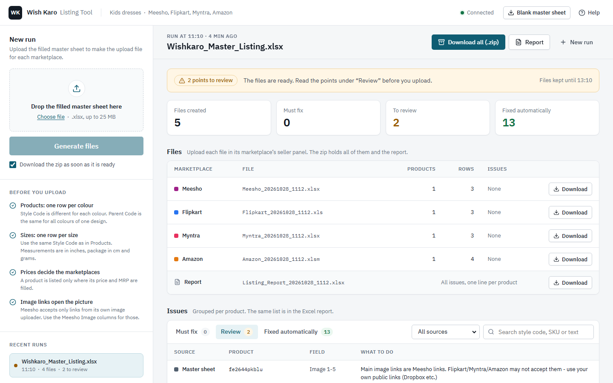
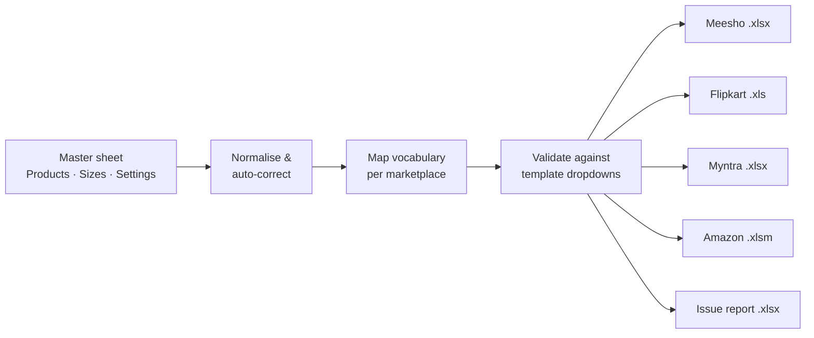
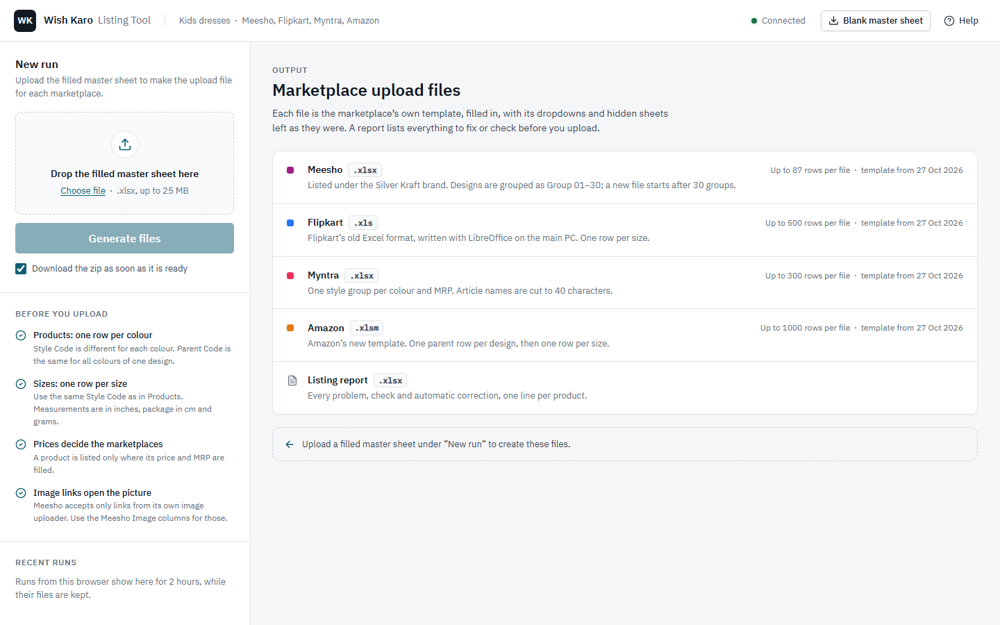
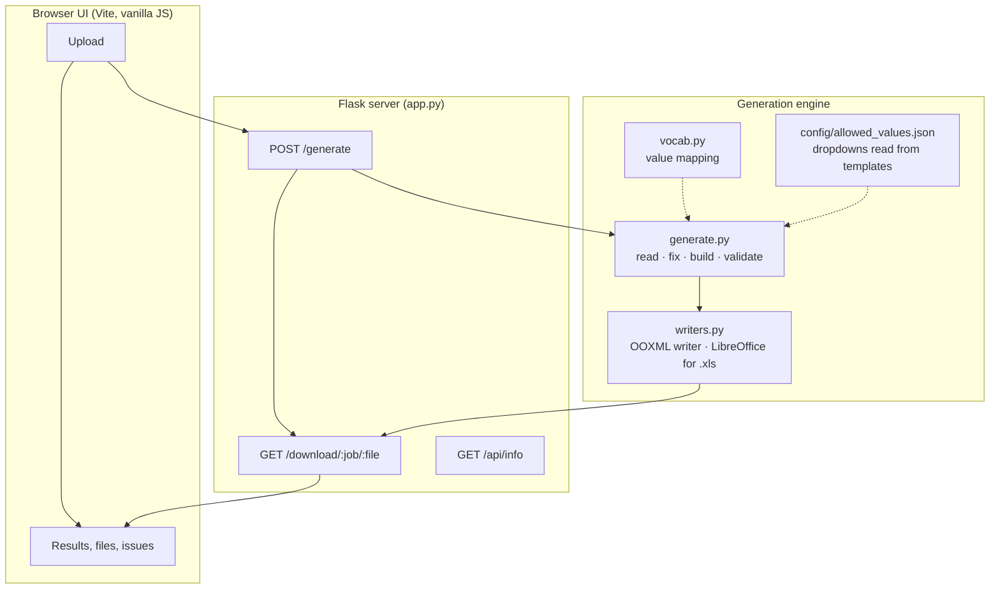

<div align="center">

# WKLister

### One catalogue sheet → ready-to-upload listings for Meesho, Flipkart, Myntra and Amazon




</div>

**WKLister** turns a single, seller-friendly master sheet into the exact upload templates each Indian
marketplace demands. It validates every value against the marketplace's own dropdowns, fixes common
data-entry mistakes, and writes into the original templates without breaking their validations,
hidden sheets or macros. Built for Wish Karo kidswear, designed to extend to any apparel category.

---

## The problem

Selling one product on four marketplaces means filling four completely different spreadsheets.

| | Meesho | Flipkart | Myntra | Amazon |
|---|---|---|---|---|
| File format | `.xlsx` | legacy `.xls` with macros | `.xlsx` | `.xlsm`, 296 columns |
| Dropdown lists to respect | 20 | 22 | 50 | 188 |
| Size `3-6 Months` written as | `3-6 Months` | `3 - 6 Months` | `3-6M` | `3 Months` → `6 Months` |
| Brand on the listing | sub-brand | brand | brand | approved brand only |

A single design in 4 colours and 8 sizes is **32 SKUs per marketplace**: about **3,700 filled cells**
in the Amazon template alone. Every cell copied by hand is a chance for a typo, a value outside the
dropdown, or a mismatched size, and each one comes back as a rejected upload days later.

## The solution

The catalogue team keeps **one master sheet**: one row per colour, one row per size. WKLister does the rest.



### Business impact

- **One source of truth.** Product data is entered once; every marketplace file is derived from it.
- **Fewer rejected uploads.** Values are checked against each marketplace's own dropdown lists before a file is produced.
- **About a minute per run** for a full catalogue across four marketplaces.
- **Zero running cost.** No cloud, no database, no paid API, no AI tokens. Runs on any Windows laptop.
- **Consistent SKUs everywhere.** `StyleCode_Size` (e.g. `bxa245pkblu_3-6_Months`) is identical on every channel, matching the existing Shopify catalogue.

---

## Features

**Data quality**
- Normalises spacing, prices (`Rs. 749`, `₹749`), sizes (`6 - 7 years`, `3-6m`) and dropdown capitalisation
- Merges duplicate product rows, clears values copied into the wrong column, rejects impossible size data
- Every correction is logged, so the source sheet can be fixed too

**Marketplace fidelity**
- Writes into the marketplaces' **original templates**, preserving data validation, conditional formatting, hidden sheets and macros
- A vocabulary layer maps one master value to each marketplace's exact spelling, and flags options a marketplace does not offer
- Platform rules built in: Amazon parent/child variations, Myntra style groups, Meesho group limits with automatic file splitting, baby vs girls departments by size

**Validation report**
- Three levels: **Must fix** (blocks a correct upload), **Review** (allowed but suspicious), **Fixed automatically**
- Grouped per product, available in the web UI and as Excel

**Web interface**
- Drag-and-drop upload, live progress, per-marketplace downloads or one zip
- Filterable, searchable issues; recent runs kept for two hours
- Fully offline: fonts and assets bundled, nothing loaded from the internet

<p align="center"></p>

---

## Accuracy

Products from hand-made, already-live marketplace files were rebuilt as master rows and regenerated.

| Marketplace | Filled cells identical to the hand-made file |
|---|---|
| Flipkart | 1200 / 1200 (100%) |
| Meesho | 496 / 512 (97%) |
| Myntra | 378 / 399 (95%) |
| Amazon (2026 template) | 3233 / 3709 (87%) |

Every difference was reviewed and is intentional: run dates and group numbers, fields WKLister fills
that were left empty, double spaces removed, and hand-typed values that are **not** in the
marketplace's dropdown (for example Amazon occasions such as `Party , Celebrations`), which Amazon
would reject.

---

## How it works



1. **Read.** `generate.py` loads the master's `Products`, `Sizes` and `Settings` sheets by header name, so columns can be reordered.
2. **Fix.** Values are normalised and suspicious data is corrected or flagged.
3. **Build.** One builder per marketplace turns each product and size into that marketplace's columns, translating values through `vocab.py`.
4. **Validate.** Every dropdown value is checked against lists extracted from the templates themselves (`refresh_templates.py` → `config/allowed_values.json`). Required fields and price sanity (price ≤ MRP) are checked too.
5. **Write.** `writers.py` edits the template's sheet XML directly instead of re-saving it through a spreadsheet library, which would silently drop data validations. Flipkart's legacy `.xls` is written through LibreOffice in headless mode.

### Design decisions

| Decision | Why |
|---|---|
| Write into the original template's XML | Spreadsheet libraries drop data validation extensions; marketplaces then reject the file |
| Match Amazon columns by attribute key, not position | Amazon re-orders columns between template versions |
| Read allowed values from the templates | A template update is picked up by re-running one script, not by editing code |
| Stateless jobs in a temp folder, deleted after 2 hours | No database, nothing to back up, no customer data kept |
| Vanilla JS + Vite, assets bundled | No framework runtime to maintain; works with no internet connection |

---

## Getting started

### Requirements

- Windows 10/11
- [Python 3.10+](https://www.python.org/downloads/) (added to PATH)
- [LibreOffice](https://www.libreoffice.org/download/) (only for the Flipkart `.xls` output)
- [Node.js 18+](https://nodejs.org/) only if you change the web interface

### Run

```bat
git clone https://github.com/Agnik47/WKlister.git
cd WKlister
start_website.bat
```

The first start installs the Python dependencies. The UI opens at **http://localhost:5050**.

### Command line

```bat
python generate.py "path\to\master.xlsx" [output_folder]
```

Or drag a master sheet onto `generate_listings.bat`.

---

## The master sheet

Download the empty sheet from the UI (**Blank master sheet**) or use `Wishkaro_Master_Listing.xlsx`.

| Sheet | One row per | Holds |
|---|---|---|
| **Products** | colour | Title, description, bullets, colours, fabric, shape, neck, sleeves, pattern, prices per marketplace, images |
| **Sizes** | size | Stock, body measurements (in), package dimensions (cm) and weight (g), optional per-size prices |
| **Settings** | — | Brand per marketplace, legal addresses, file row limits, marketplace defaults |

| Key | Example | Role |
|---|---|---|
| Style Code | `bxa245pkblu` | One per colour |
| Parent Code | `bxa245` | Groups the colours of one design (Amazon parent, Meesho/Flipkart group) |
| SKU | `bxa245pkblu_3-6_Months` | Style Code + size, identical on every marketplace |

A product is listed only on the marketplaces where its price and MRP are filled.

---

## Marketplace rules

<details>
<summary><b>Sizes and departments</b></summary>

| Master | Flipkart | Myntra | Amazon |
|---|---|---|---|
| `3-6 Months` | `3 - 6 Months` | `3-6M` | `3 Months` → `6 Months` |
| `1-2 Years` | `1 - 2 Years` | `1-2Y` | `12 Months` → `24 Months` |
| `5-6 Years` | `5 - 6 Years` | `5-6Y` | `5 Years` → `6 Years` |

Sizes up to `1-2 Years` are listed in the baby girls department, larger sizes in girls.

</details>

<details>
<summary><b>Amazon</b></summary>

- Supports Amazon's 2026 template: labels in row 4, attribute keys in row 5, data from row 7.
- One parent row per design, titled with the words all its colours share; one child row per size.
- Package dimensions = item dimensions + configurable padding.
- Minimum and maximum seller prices derived from the selling price and MRP.
- Browse nodes, special features, occasions, holidays, life events and seasons are configurable; only values present in Amazon's dropdowns are written.

</details>

<details>
<summary><b>Meesho</b></summary>

- Listed under a separate sub-brand; the main brand name is replaced in titles and descriptions.
- HSN mapped to the closest code Meesho's list allows.
- Up to 30 groups and 87 rows per file; larger catalogues are split without breaking a design across files.
- Wrong/defective return price derived from the selling price.

</details>

<details>
<summary><b>Myntra</b></summary>

- `styleGroupId` per colour and MRP.
- Article names shortened to 40 characters at a word boundary.

</details>

<details>
<summary><b>Flipkart</b></summary>

- Written into Flipkart's legacy `.xls` through LibreOffice, keeping its macros and lists.
- Delivery charges, procurement type and SLA configurable.

</details>

---

## Extending

**New option (colour, fabric, neck style…)**: add one line to `vocab.py` with each marketplace's spelling, then:

```bat
python vocab.py          :: verifies every spelling exists in each marketplace's dropdown
python build_master.py   :: regenerates the blank master sheet with the new option
```

**Marketplace releases a new template**: replace the file in `templates/` and run `python refresh_templates.py`. It re-extracts every dropdown list and reports any mapping that no longer matches.

**New category**: add the category's templates, a vocabulary section and a builder. The pipeline, writer, validation and UI are category-agnostic.

---

## Project structure

```text
├── app.py                  Flask server: UI, /generate, /download, /api/info
├── generate.py             engine: read, fix, build per marketplace, validate, report
├── vocab.py                master vocabulary → marketplace spellings, with self-check
├── master_spec.py          master sheet schema and default settings
├── writers.py              template-preserving OOXML writer; LibreOffice driver for .xls
├── build_master.py         generates the blank master sheet
├── refresh_templates.py    extracts dropdown lists from the templates
├── templates/              marketplace templates
├── config/                 extracted dropdown lists (allowed_values.json)
├── docs/                   screenshots
└── frontend/
    ├── src/
    │   ├── api/            HTTP client
    │   ├── state/          store, actions, local storage
    │   ├── components/     header, sidebar (upload, recent runs), output (results, files, issues)
    │   ├── lib/            DOM, formatting, issue grouping
    │   ├── data/           marketplace metadata
    │   └── styles/         design tokens, controls, layout
    └── dist/               production build served by app.py
```

## Development

```bat
dev.bat                    :: server auto-restarts on .py changes, UI rebuilds on save
cd frontend && npm run dev :: Vite dev server on :5173, proxying the API on :5050
cd frontend && npm run build
```

The UI only presents results; all generation logic lives in the Python engine.

| Script | Purpose |
|---|---|
| `start_website.bat` | Install dependencies, rebuild the UI when Node.js is present, start the server |
| `dev.bat` | Development mode with auto-rebuild and auto-restart |
| `publish.bat` | Build the UI, commit and push |
| `make_release.bat` | Build a self-contained zip for machines without Git |

---

## Limitations and roadmap

- **Category:** kids dresses today; the architecture supports more categories with their templates and vocabulary.
- **Concurrency:** jobs run one at a time because LibreOffice is single-instance. Suitable for a single catalogue team.
- **Flipkart:** the template's "Fast Validate" progress pop-up is not preserved by LibreOffice; macros and data are.
- **Options a marketplace does not offer** (e.g. Velvet on Meesho) are left blank and reported for manual choice.
